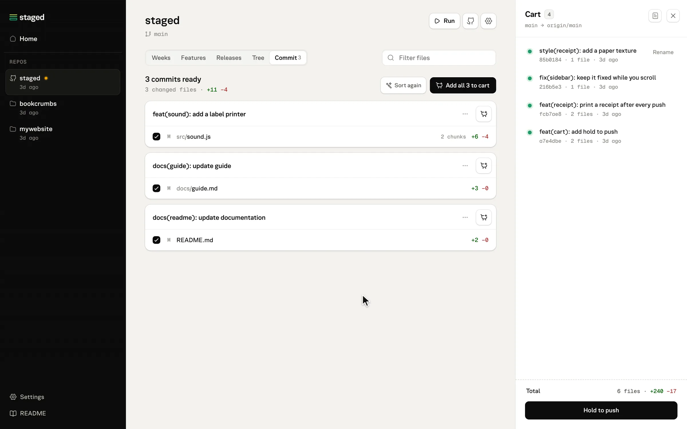
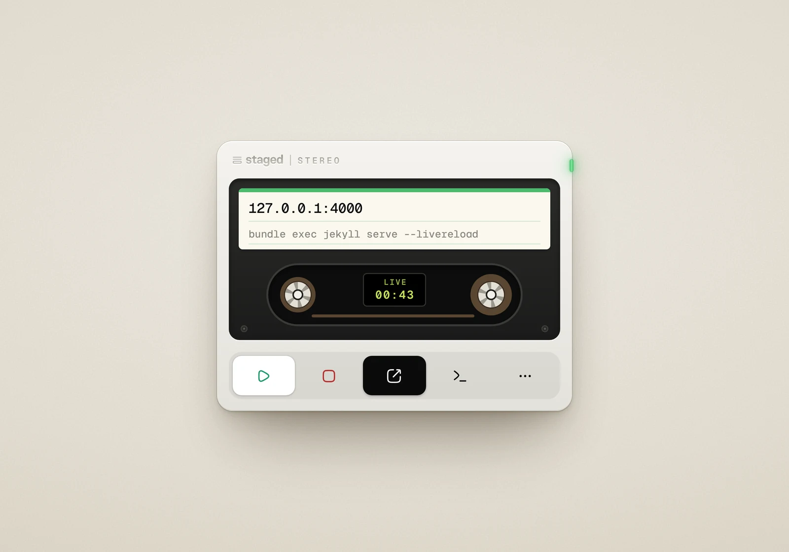

<div align="center">


<h1>staged</h1>

<p><b>Commit your work. Properly.</b></p>

<p>
  A fun, friendly app for git that takes the place of the terminal. It sorts your changes into commits, names them for you, and runs your dev servers.
</p>

<p>
  <a href="https://staged.vyshnav.xyz"></a>
  <a href="https://github.com/Vyshnav2255/staged/releases/latest"></a>
  <a href="#requirements"></a>
  <a href="#license"></a>
  <a href="https://buymeacoffee.com/vyshnav"></a>
</p>

<p>
  <a href="#get-started"><b>Get started</b></a>
  &nbsp;·&nbsp;
  <a href="#commits-that-sort-and-name-themselves">How grouping works</a>
  &nbsp;·&nbsp;
  <a href="#run-your-project">Run</a>
  &nbsp;·&nbsp;
  <a href="https://staged.vyshnav.xyz">Website</a>
</p>



</div>

---

Git is powerful, but most days you only need a handful of commands, and the terminal makes every one of them feel like work. You end up with one giant commit called `fix stuff`, or you spend ten minutes picking files apart by hand.

staged does that part for you. It reads your uncommitted changes, splits them into commits that make sense, and writes each message in your own style. You check them, tweak anything you like, add them to the cart, and hold to push. A receipt prints. It's git, made fun to use.

> [!NOTE]
> Everything runs on your computer. There's no account and no AI, and nothing leaves your machine. staged only answers on `localhost`.

---

## Features

### Commits that sort and name themselves

This is the heart of staged. Open **Commit** and your changes are already split into suggested commits:

- **Connected files travel together.** A new script, its styles, and the files that include it or use its `data-*` hooks.
- **Content gets its own commit.** A collection like `_books/` plus its `Images/Books/`.
- **Files that usually change together stay together.** staged learns this from your past commits.
- **Unrelated small edits stay separate.** Small changes join only when another signal links them.
- **Big files are split by chunk.** One file can feed two commits when its changes belong to different work.

Every commit comes with a message that says what actually changed, like `Replaced Geist font with Akt` or `feat(books): add notes for …`, with a short list of details underneath. It matches your repo: **Gitmoji**, **Conventional** or **Both**, past tense or imperative, and the verbs you already use. Groups staged isn't sure about are marked *Check grouping*.

Then make it yours:

- Untick files, or pick single **chunks** of a file. The rest stays in your working copy.
- **Move** a file to another commit, or drag it onto another card. staged remembers the correction next time.
- Click a message to edit it, or pick an emoji from the **gitmoji picker**.
- Add an optional **description** from a commit's ⋯ menu.
- **Discard** a file, a chunk or a whole commit. A copy goes to `.git/staged-trash/` first, and **Undo** brings it back.

staged remembers your groups, messages and edits as you work. Leave the tab or reload, and it picks up where you left off.

### Cart, push and receipt

- **Add to cart** commits one group. **Add all to cart** lets you review, reorder and merge first.
- **Hold to push** sends the cart, and a receipt prints. Save it as an image.
- **Undo** puts the last commit made here back into your changes.
- **Rename** the last commit from the Tree or `⌘K`. If it's already pushed, staged warns you and uses `--force-with-lease`.
- Every week gets a **statement** too, printed from Home.

Before you commit, staged flags secrets files, API keys, huge files, conflict markers, `console.log` and `debugger`.

### Run your project

No more keeping a terminal tab open for your dev server. Press **Run** and a cassette deck slides in with your project's own commands. Press play, and staged opens the page the moment it's live. The output is one click away, and when something breaks, **Copy error** copies a ready-to-paste report.

<p align="center">
  
</p>

staged finds the commands from files your project already has:

| Project has | Commands |
| --- | --- |
| `Gemfile` / `_config.yml` (Jekyll) | Serve site (`bundle exec jekyll serve --livereload`), Build site |
| `package.json` | Its scripts, run with npm, pnpm, yarn or bun (from the lockfile) |
| `Makefile` | Each `make` target |
| `Cargo.toml` / `go.mod` | Run and test |
| `manage.py` (Django) | Run server |
| Just an `index.html` | Serve folder (`python3 -m http.server`) |

The main command sits in the deck and the rest are under **More commands**. Add your own with **Add a command**. They're saved in `~/.config/staged/run.json`, not in the repo. Commands run in your login shell, so nvm, rbenv and your `PATH` work. Stopping a command, or quitting staged, stops everything it started.

### See your work

| View | What it shows |
| --- | --- |
| **Home** | This week against last week, your streak, what's **waiting on you** and six months of activity. |
| **Overview** | The codebase at a glance (languages, frameworks, package manager, license), then weekly drops with *Copy notes* for release notes. |
| **Features** | Changes grouped by the part of the project they touched, each with a month-by-month *story*. |
| **Releases** | Commits between tags, with *New release* (publishes a GitHub Release) and *Changelog*. |
| **Tree** | Every branch, merge and tag as lanes. Hover a commit to light up its history. |
| **Health** | Site weight per week, plus heavy images and videos with a **Shrink** button. See [Shrink images and videos](#shrink-images-and-videos). |

### Shrink images and videos

**Health** lists images over 250 KB or not WebP, and videos over 2 MB or in `.mov`. Press **Shrink** on one, or **Shrink all**:

- Images become WebP, at most 2400 px wide. Social cards and icons stay PNG or JPEG, just smaller.
- Videos become MP4 (H.264, at most 1920 px wide, ready to stream).
- Links to a renamed file are updated across your HTML, Markdown, CSS, JavaScript and data files.
- A result is kept only when it saves at least 10%. A copy of every original goes to `.git/staged-trash/`, and the changes show up in **Commit** for you to check.

Images use [sharp](https://sharp.pixelplumbing.com), which installs once into staged's folder the first time you press **Install** (about 20 MB). Videos use [ffmpeg](https://ffmpeg.org) if it's on your computer (`brew install ffmpeg` on a Mac).

### Keyboard shortcuts

| Key | Does |
| --- | --- |
| `⌘K` | Jump to any repo, view, action or commit |
| `/` | Search or filter |
| `R` | Re-read repos |
| Alt-click a legend item | Show only that type |

---

## Get started

You need [Node 18+](https://nodejs.org) and git. Nothing else to install up front.

```sh
git clone --branch v1.2.0 https://github.com/Vyshnav2255/staged.git
cd staged
npm start
```

This clones the latest release. staged updates itself from there, so you never clone again. It asks how you want to run it:

- **Keep it running** (recommended): in the background and at every login. On a Mac it shows up as **staged** in System Settings › General › Login Items. On Linux it's a systemd user service, and on Windows it's in your Startup folder.
- **Just for now**: in that terminal window. Press `o` to open it, `r` to restart and `q` to quit.

staged lives at http://localhost:4321. Run `npm start` again any time to open it, stop it or switch modes. To remove the background copy: `npm run remove`. If you move staged's folder, run `npm run setup` once in the new place.

Use your browser's **Install app** (Chrome, Edge, Arc) or **File › Add to Dock** (Safari) to give it its own window and icon.

---

## Your repos

The first time it runs, staged finds the folder your repos live in (`~/GitHub`, `~/Developer`, `~/Projects`, `~/code` and similar) and shows every git repo inside it. New repos you clone there appear on their own.

To change that, open **Settings › Repos**:

- **Add** a folder of repos, or a single repo from anywhere, like `~/work` or `~/code/my-app`.
- **Remove** a folder or repo you added.
- **Untick** a repo to hide it everywhere. Nothing in the repo is touched.

You can also pass folders when starting it: `npm start -- ~/work ~/side-projects`.

### Naming your own features

Features are guessed from folder and file names. To name them yourself, add `.changes.json` to a repo:

```json
{
  "areas": {
    "Now page": ["_includes/now/**", "Images/now/**", "assets/audio/now/**", "_sass/_now*.scss"],
    "Books": ["_books/**", "Images/books/**"]
  },
  "ignore": ["package-lock.json"]
}
```

Rules are checked in order. Files that match none fall back to the guess.

---

## Updating

staged updates itself. When a new version is out, a card in the sidebar says so. Press **Update now**, and staged restarts in place in a few seconds, on the page you were on. You can also check from `⌘K`.

This works when you installed with `git clone`. If you changed staged's own files, commit or undo those first.

### Shipping a version (maintainers)

Run `npm run release` (or `npm run release -- 1.1.0`). It bumps `package.json`, commits, tags and pushes. Then publish it as a GitHub Release, from staged's **Releases** screen (*New release*) or on GitHub. Only published releases reach people, a tag on its own doesn't.

---

## Commit plans for scripts and agents

Scripts and coding agents can read the same suggested commits without opening the app:

```sh
staged plan --json
staged plan /path/to/repo --json
```

It prints JSON in the `staged.commit-plan.v1` schema: each commit's subject in Gitmoji and Conventional style, the suggested emoji, how sure staged is and why, and which files or chunks go where. It never commits or edits the repo. Add `--include-diff` only when the agent also needs the diffs.

---

## How it stays local

- Grouping and messages come from rules and your own history: imports, `data-*` hooks, folders, files that change together and the words you use. No model or online service is involved.
- The history index in `~/.config/staged/group-index/` stores commit IDs, subjects and paths, never your code or diffs.
- Settings and anything staged learns from your corrections live in `~/.config/staged/` (on Windows, `%APPDATA%\staged`), never in your repos.
- Commits are built in a temporary index, so anything you staged yourself elsewhere is left alone. Git hooks don't run for these commits.
- The server only answers on `localhost`, and only to this page.

---

## Requirements

- macOS, Windows or Linux. On Linux the folder picker uses `zenity`; without it, type the path.
- [Node 18+](https://nodejs.org) and git.
- Works with GitHub, GitLab (including self-hosted) and Bitbucket remotes.

---

## Contributing

Pull requests are welcome. Read [CONTRIBUTING](CONTRIBUTING.md) first.

---

## License

staged is source-available, not open source. You can use it for free anywhere, including at work. You can fork it only to send a pull request, and you can't publish, rebrand or sell your own version. The name and logo are not covered. See [LICENSE](LICENSE).

---

## Support staged

staged is free and stays free. If it saves you time, you can buy me a coffee ☕. There's a button for it in the app too, under **About**.

<div align="center">

<a href="https://buymeacoffee.com/vyshnav"></a>

</div>

---

<div align="center">

<b>Made by Vyshnav Gangadharan</b>

<a href="https://vyshnav.xyz"></a>
<a href="https://staged.vyshnav.xyz"></a>

</div>
